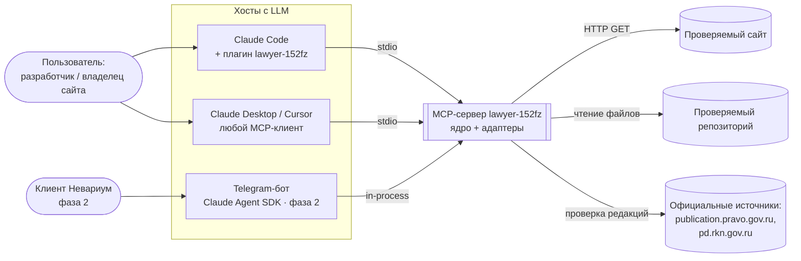
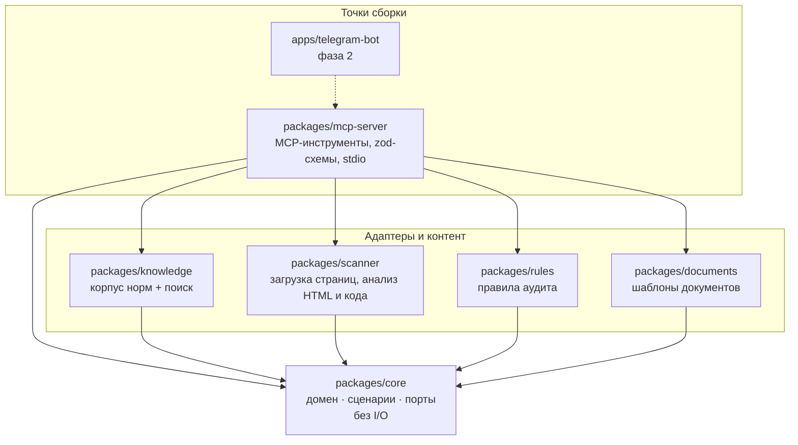
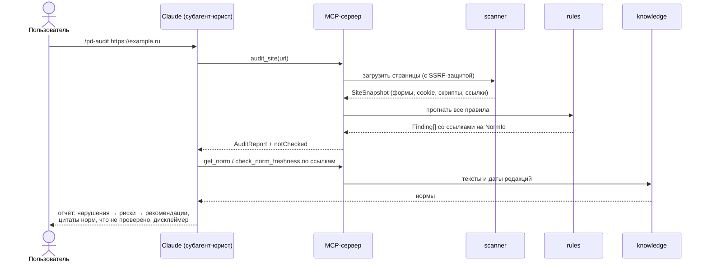

# Архитектура Lawyer 152-FZ

> Статус: **черновик этапа «Архитектор»** · 2026-10-23
> Входные данные: бриф владельца (см. раздел 1). Решения с последствиями вынесены в [ADR](adr/).

## 1. Бриф владельца (кратко)

| | |
|---|---|
| Назначение | ИИ-юрист по 152-ФЗ «О персональных данных» и взаимодействию с Роскомнадзором |
| Пользователи | ① владелец и проекты Невариум → ② клиенты (услуга) → ③ open-source сообщество |
| Формы | общее ядро → MCP-сервер → плагин Claude Code (глобальная установка). Telegram-бот — фаза 2 |
| Функции MVP | аудит сайта и кода · генерация документов · консультации со ссылками на нормы |
| Знания | курированная база официальных текстов с датами редакций + онлайн-проверка актуальности |
| Стек / лицензия | TypeScript, монорепозиторий pnpm · AGPL-3.0 |
| Вне MVP | мониторинг изменений законодательства, бот, биллинг |

## 2. Главная идея

**Ядро знает закон и умеет проверять, но не «думает». Думает Claude.**

Ядро — детерминированная библиотека: хранит нормы, ищет по ним, сканирует сайт, прогоняет правила, заполняет шаблоны.
Рассуждение, диалог и итоговые формулировки делает модель-хост (Claude Code сейчас, Claude Agent SDK в боте потом),
вызывая ядро через MCP-инструменты. Подробно — [ADR-0001](adr/0001-deterministic-core-llm-in-host.md).

Что это даёт:
- плагину не нужен API-ключ — работает на подписке пользователя;
- ядро покрывается обычными быстрыми тестами, без токенов и случайности;
- каждая ссылка на закон в ответе проверяема: модель цитирует только то, что вернул инструмент `get_norm`.

## 3. Контекст системы (C4, уровень 1)



## 4. Модули (C4, уровень 2)

Гексагональная архитектура («порты и адаптеры»): домен в центре не знает ни про HTTP, ни про файлы, ни про MCP.
Зависимости направлены **только внутрь**, это проверяется в CI ([ADR-0002](adr/0002-monorepo-hexagonal-typescript.md)).



| Пакет | Ответственность | Зависит от | Внешние библиотеки (ориентир) |
|---|---|---|---|
| `core` | Типы домена (`Norm`, `Finding`, `AuditReport`, `OperatorProfile`), сценарии (`AuditSite`, `AuditCodebase`, `GenerateDocument`, `LookupNorms`), порты (`NormRepository`, `PageLoader`, `SourceFreshnessChecker`, `Clock`), `Result<T, E>` и доменные ошибки | — | `zod` |
| `knowledge` | Корпус норм в `data/` (Markdown + frontmatter), валидация, сборка индекса, полнотекстовый поиск с русской морфологией. Реализует `NormRepository` и `SourceFreshnessChecker` | `core` | `minisearch`, стеммер для русского |
| `scanner` | `PageLoader`: статическая загрузка (fetch); браузерный рендер для SPA — после спайка (R3); извлечение форм, чекбоксов согласий, cookie, сторонних скриптов (Метрика, GA, пиксели), ссылок на политику; сканер исходников (поля ПДн, внешние SDK, логирование) | `core` | `cheerio`, `playwright-core` (опционально) |
| `rules` | Реестр правил аудита. Каждое правило — отдельный модуль: `id`, ссылки на нормы, чистая функция `check(snapshot) → Finding[]` | `core` | — |
| `documents` | Шаблоны: политика обработки ПДн, согласие на обработку, согласие на распространение, уведомление в РКН, уведомление о трансграничной передаче. Вход — `OperatorProfile`, валидируется zod | `core` | шаблонизатор (выбор — планировщик) |
| `mcp-server` | Точка сборки: создаёт адаптеры, внедряет их в сценарии, регистрирует MCP-инструменты, транспорт stdio | все выше | `@modelcontextprotocol/sdk` |
| `plugins/lawyer-152fz` | Плагин Claude Code: субагент-юрист, скиллы-команды, `.mcp.json`, собранный бандл сервера | бандл `mcp-server` | — |

## 5. Структура репозитория

```
lawyer-152fz/
├── .claude-plugin/
│   └── marketplace.json          # репо = маркетплейс: /plugin marketplace add nevarium-spb/lawyer-152fz
├── plugins/lawyer-152fz/         # сам плагин (то, что ставится глобально)
│   ├── .claude-plugin/plugin.json
│   ├── .mcp.json                 # node ${CLAUDE_PLUGIN_ROOT}/server/index.mjs
│   ├── agents/lawyer-152fz.md    # субагент: роль, правила цитирования, дисклеймер
│   ├── skills/
│   │   ├── pd-audit/SKILL.md     # /pd-audit <url | путь к проекту>
│   │   ├── pd-docs/SKILL.md      # /pd-docs <тип документа>
│   │   └── pd-consult/SKILL.md   # автоактивация на вопросы о ПДн и РКН
│   └── server/index.mjs          # бандл MCP-сервера (кладёт релизный CI, руками не правится)
├── packages/
│   ├── core/
│   ├── knowledge/
│   │   └── data/<акт>/<статья>.md  # нормы: одна статья — один файл
│   ├── scanner/
│   ├── rules/
│   ├── documents/
│   └── mcp-server/
├── apps/
│   └── telegram-bot/             # фаза 2, пока только README
├── evals/                        # юридические кейсы с эталонами (см. §9)
├── docs/
│   ├── ARCHITECTURE.md
│   └── adr/
├── .changeset/                   # версии и changelog
├── pnpm-workspace.yaml
├── tsconfig.json                 # одна программа проверки типов (ADR-0008)
└── LICENSE                       # AGPL-3.0
```

## 6. Доменная модель

```ts
// Идентификатор нормы — стабильный и человекочитаемый: акт/статья/часть/пункт
type NormId = `${ActId}/art-${string}` | `${ActId}/art-${string}/part-${number}`;
// пример: "152-fz/art-18/part-5", "koap/art-13.11/part-1"

interface Norm {
  id: NormId;
  act: ActId;                 // "152-fz" | "koap" | "pp-1119" | ...
  heading: string;            // заголовок статьи
  text: string;               // официальный текст
  editionDate: string;        // ISO-дата редакции, по которой сверен текст
  sourceUrl: string;          // официальный источник
  verifiedAt: string;         // когда человек сверил текст с источником
  sha256: string;             // хеш текста — для проверки дрейфа
}

type Severity = 'critical' | 'high' | 'medium' | 'low' | 'info';

interface Finding {
  ruleId: string;             // "PD-FORM-CONSENT-001"
  kind: 'violation' | 'risk' | 'recommendation';
  severity: Severity;
  title: string;
  evidence: Evidence[];       // где найдено: URL + селектор, файл + строка
  normRefs: NormId[];         // ≥1, каждая обязана существовать в базе
  remediation: string;
  confidence: 'deterministic' | 'needs-review'; // needs-review — финальное суждение за моделью/юристом
}

interface AuditReport {
  target: { type: 'site' | 'codebase'; ref: string };
  generatedAt: string;
  kbVersion: string;          // версия базы норм, например "kb-2026.10.23"
  findings: Finding[];
  notChecked: string[];       // честный список того, что инструмент проверить не может
}
```

`OperatorProfile` (вход для документов): наименование, ИНН/ОГРН, адрес, цели обработки, категории ПДн и субъектов,
третьи лица, трансграничная передача, место хранения баз, ответственный за организацию обработки. Схема — zod,
ошибки валидации возвращаются модели списком, чтобы она дозапросила недостающее у пользователя.

## 7. Контракт MCP-инструментов

Инструменты — публичный API проекта. Ломающие изменения только с мажорной версией.

| Инструмент | Вход | Выход | Назначение |
|---|---|---|---|
| `search_norms` | `query`, `acts?`, `limit?` | список `{id, heading, snippet, editionDate}` | найти релевантные нормы |
| `get_norm` | `id` | `Norm` целиком | **единственный** способ получить текст для цитаты |
| `check_norm_freshness` | `ids[]` | `{id, status: fresh / stale / unknown, checkedAt}` | сверка с официальным источником |
| `audit_site` | `url`, `maxPages?`, `render?` | `AuditReport` | аудит сайта |
| `audit_codebase` | `path` | `AuditReport` | аудит исходников (только чтение) |
| `list_document_templates` | — | список шаблонов и требуемых полей | что умеем генерировать |
| `render_document` | `templateId`, `profile` | Markdown или список ошибок валидации | генерация документа |

Ресурс `lawyer://kb/info` отдаёт версию базы, список актов и даты редакций.

## 8. Ключевые потоки

### 8.1 Аудит сайта (`/pd-audit https://example.ru`)



### 8.2 Консультация

Скилл `pd-consult` → `search_norms` → `get_norm` по найденному → при необходимости `check_norm_freshness` →
ответ, где каждое утверждение о праве опирается на процитированную норму. Нет нормы в базе — модель прямо говорит
«в базе нет, проверьте по официальному источнику», а не отвечает по памяти.

### 8.3 Генерация документа

`/pd-docs policy` → `list_document_templates` → модель собирает `OperatorProfile` в диалоге →
`render_document` → при ошибках валидации дозапрос недостающих полей → Markdown-файл в проект пользователя.

## 9. Качество и проверки

| Уровень | Что проверяет | Где |
|---|---|---|
| Unit | Каждое правило на HTML/код-фикстурах: «нарушение найдено» и «ложного срабатывания нет» | `packages/rules` |
| Целостность базы | frontmatter валиден; хеши совпадают | CI, `knowledge` |
| Ссылочная целостность | каждый `normRefs` правил и шаблонов существует в базе. Живёт в тестах точки сборки, чтобы `rules` и `documents` не зависели от `knowledge` | CI, `mcp-server` |
| Контракт | Снапшоты JSON-схем MCP-инструментов: случайная ломка API валит сборку | `mcp-server` |
| Интеграция | MCP-клиент в памяти вызывает инструменты сервера end-to-end | `mcp-server` |
| Golden | Сгенерированные документы сравниваются с эталонами | `documents` |
| Evals | Юридические кейсы в YAML: вопрос → обязательные нормы в ответе → запрещённые утверждения. В фазе 1 прогоняются вручную в Claude Code, позже автоматически | `evals/` |
| Границы | Пакеты не импортируют то, что им запрещено (dependency-cruiser) | CI |

Нефункциональные требования: старт MCP-сервера < 1 с; работа офлайн (кроме `check_norm_freshness` и аудита
внешних сайтов); Windows / macOS / Linux; Node ≥ 22.12 LTS (поддержка Node 20 закончилась в апреле 2026; 22.12 — минимум для Vitest 5).

## 10. Безопасность и собственное соответствие 152-ФЗ

Подробно — [ADR-0006](adr/0006-security-untrusted-content-no-pd-retention.md). Кратко:

- **Содержимое сайтов и репозиториев — недоверенные данные.** Текст страницы может содержать prompt injection;
  инструменты помечают такие поля, субагент обучен не исполнять инструкции из них.
- **SSRF-защита** в `PageLoader`: только http(s), лимиты размера и времени. Частные адреса (localhost, 10.x, 192.168.x)
  разрешены в режиме плагина (аудит своего dev-сервера) и запрещены в режиме бота.
- **Сервер не хранит ПДн:** без состояния, без логирования содержимого страниц и профилей операторов.
- **Аудит кода — только чтение.** Правки делает Claude после явного подтверждения пользователя.
- **Цепочка поставок:** минимум зависимостей, lockfile, публикация npm с provenance.
- **Бот (фаза 2) — сам оператор ПДн:** хранение в РФ, уведомление РКН, политика. Перед запуском проходит собственный `/pd-audit`.

## 11. Версионирование и поставка

- Пакеты — SemVer через Changesets. База норм — отдельная версия по дате `kb-ГГГГ.ММ.ДД`, печатается в каждом отчёте.
- Плагин ставится из GitHub-маркетплейса; бандл сервера собирает релизный CI и кладёт в `plugins/lawyer-152fz/server/`
  ([ADR-0005](adr/0005-distribution-bundled-plugin-and-npm.md)).
- `@lawyer-152fz/mcp-server` публикуется в npm для других MCP-клиентов (`npx -y @lawyer-152fz/mcp-server`).

Установка для пользователя:

```
/plugin marketplace add nevarium-spb/lawyer-152fz
/plugin install lawyer-152fz@lawyer-152fz
```

## 12. Риски и открытые вопросы

| # | Риск / вопрос | Как снимаем | Кто |
|---|---|---|---|
| R1 | Юридическая ошибка в базе или шаблоне → вред клиенту | Дисклеймер; `verifiedAt` у каждой нормы; **до продажи услуги — ревью базы и шаблонов практикующим юристом** | Владелец |
| R2 | Доступ к официальным источникам программно (формат, блокировки, антибот) | Спайк в начале реализации; запасной вариант — `status: unknown` + веб-поиск силами модели | Планировщик |
| R3 | SPA-сайты (React) не видны статической загрузке, а у плагина нет `node_modules` для Playwright | Спайк: (а) вшить `playwright-core` в бандл и использовать системный Chrome; (б) инструмент `audit_html`, куда хост передаёт DOM, отрисованный своим браузером. До решения — `audit_codebase` по исходникам + пометка в `notChecked` | Архитектор / Тимлид |
| R4 | Ложные срабатывания правил подорвут доверие | Две фикстуры на правило (с нарушением и без); `confidence: needs-review` для эвристик | Тестировщик |
| R5 | Свободно ли имя `@lawyer-152fz` в npm | Проверить до первого релиза; запасной вариант — `@nevarium/lawyer-152fz-*` | DevOps |
| R6 | Изменения в законе после `verifiedAt` | `check_norm_freshness` + плановое обновление базы (мониторинг — фаза 2) | DBA (база норм) |

## 13. Реестр решений (ADR)

| № | Решение |
|---|---|
| [0001](adr/0001-deterministic-core-llm-in-host.md) | Ядро детерминировано, рассуждает LLM-хост |
| [0002](adr/0002-monorepo-hexagonal-typescript.md) | Монорепозиторий pnpm, TypeScript strict, гексагональная архитектура |
| [0003](adr/0003-knowledge-base-as-versioned-files.md) | База норм — файлы в git + полнотекстовый поиск, без векторной БД |
| [0004](adr/0004-audit-rules-registry.md) | Правила аудита — реестр независимых модулей |
| [0005](adr/0005-distribution-bundled-plugin-and-npm.md) | Поставка: бандл в плагине + npm-пакет |
| [0006](adr/0006-security-untrusted-content-no-pd-retention.md) | Безопасность: недоверенный контент, SSRF, без хранения ПДн |
| [0007](adr/0007-license-agpl-and-legal-content-policy.md) | AGPL-3.0 и политика правового контента |
| [0008](adr/0008-internal-packages-as-ts-source.md) | Внутренние пакеты подключаются как исходники TypeScript |
