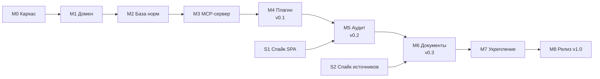

# План реализации Lawyer 152-FZ

> Этап «Планировщик» · 2026-10-24 · основа — [ARCHITECTURE.md](ARCHITECTURE.md) и [ADR](adr/)

## Как читать этот план

- **Веха (M)** — законченный кусок, после которого что-то реально работает.
- **Задача (T)** — шаг внутри вехи, 0,5–3 дня работы. У каждой есть роль, зависимости и **критерий готовности** —
  проверяемое условие «задача сделана», а не «вроде работает».
- **Спайк (S)** — исследование с жёстким лимитом времени, результат — решение (новый ADR), а не продакшн-код.
- Размер: **S** ≤ ½ дня · **M** 1–2 дня · **L** 3+ дня.

Срезы выпускаются **вертикально**: каждая версия — работающий агент, который можно поставить и попробовать.

| Версия                 | Что умеет                                                     | Вехи  |
| ---------------------- | ------------------------------------------------------------- | ----- |
| **v0.1 «Консультант»** | отвечает на вопросы по 152-ФЗ с цитатами из базы              | M0–M4 |
| **v0.2 «Аудитор»**     | + аудит сайта и кода                                          | M5    |
| **v0.3 «Документы»**   | + генерация документов, проверка актуальности норм            | M6    |
| **v1.0**               | укреплённый, проверенный, опубликованный в npm и маркетплейсе | M7–M8 |



## Процесс выполнения задачи (по схеме ролей)

```
Тимлид берёт задачу → ветка вехи (feat/m2-knowledge)
  → исполнитель: сначала тест, потом код (TDD)
  → Ревьюер (/review): «Исправления» → назад исполнителю | «Готово» →
  → Ведущий: lint + typecheck + test + depcruise зелёные → коммит задачи
  → «Все задачи вехи сделаны?» нет → следующая задача | да →
  → аудиты по необходимости (Security / DBA / Производительность) → PR вехи → CI зелёный
  → Владелец: «да» → merge в main
```

- Ветка на веху, коммит на задачу (`feat(knowledge): T2.4 поисковый индекс`), PR на веху.
- Стенды Timeweb к плагину не применимы (он не деплоится на сервер); понадобятся для бота в фазе 2.

## Общий критерий готовности (Definition of Done) для любой задачи

1. Тесты написаны и зелёные; покрытие не ниже порога пакета (`core`, `rules` — 90 %, остальные — 80 %).
2. `pnpm lint`, `pnpm typecheck`, `pnpm depcruise` зелёные.
3. Публичные функции и MCP-инструменты имеют JSDoc / описание.
4. Нет `any`, нет `// @ts-ignore` без комментария-обоснования.
5. Ревьюер дал «Готово».
6. Если менялось решение из ADR — обновлён или добавлен ADR.

## Зафиксированные версии (проверено в npm 2026-10-24)

| Инструмент                 | Версия                   | Примечание                                                                           |
| -------------------------- | ------------------------ | ------------------------------------------------------------------------------------ |
| Node.js                    | ≥ 26 (последняя)         | политика «всегда последние», [ADR-0009](adr/0009-latest-versions-policy.md)          |
| pnpm                       | 12.15.0                  | через `corepack enable`; поле `packageManager`                                       |
| TypeScript                 | **7.0.2** (алиас `tsc7`) | проверка типов; 6.0.3 — только движок typescript-eslint до поддержки TS 7 (ADR-0009) |
| @types/node                | 26.6.5                   | соответствует Node 26                                                                |
| @modelcontextprotocol/sdk  | 1.32.2                   | поддерживает zod 3.25+ и 4                                                           |
| zod                        | 4.6.7                    |                                                                                      |
| Vitest                     | 5.0.5                    |                                                                                      |
| ESLint / typescript-eslint | 10.13.0 / 8.72.0         | flat config                                                                          |
| Prettier                   | 3.9.10                   |                                                                                      |
| esbuild                    | 0.28.2                   | только бандл сервера; библиотеки не собираются (ADR-0008)                            |
| @changesets/cli            | 3.0.3                    |                                                                                      |
| dependency-cruiser         | 18.7.0                   |                                                                                      |
| minisearch                 | 7.2.0                    |                                                                                      |
| snowball-stemmers          | 0.6.0                    | русский стеммер; проверить в T2.4                                                    |
| cheerio                    | 1.2.0                    |                                                                                      |
| gray-matter                | 4.0.3                    | frontmatter норм                                                                     |
| handlebars                 | 4.7.10                   | шаблоны документов (кандидат, решается в T6.1)                                       |

Обновление версий — отдельными PR через Dependabot.

---

## M0. Каркас монорепозитория и CI

Роли: Тимлид, DevOps · Результат: пустые пакеты собираются, тестируются и проверяются в CI.

| ID   | Задача                                                                                                                                            | Зав.      | Размер | Критерий готовности                                                                            |
| ---- | ------------------------------------------------------------------------------------------------------------------------------------------------- | --------- | ------ | ---------------------------------------------------------------------------------------------- |
| T0.1 | `corepack enable`; корневой `package.json` (`packageManager`, `engines`), `pnpm-workspace.yaml`, `.nvmrc`                                         | —         | S      | `pnpm install` на чистом клоне проходит                                                        |
| T0.2 | `.gitattributes` (`* text=auto eol=lf`), `.gitignore`, `.editorconfig`; перенормализовать уже закоммиченные файлы                                 | —         | S      | `git ls-files --eol` показывает только `lf` — иначе хеши норм разойдутся между Windows и Linux |
| T0.3 | `tsconfig.json` (strict-флаги из ADR-0002), 6 пакетов-заготовок с `exports` на исходники ([ADR-0008](adr/0008-internal-packages-as-ts-source.md)) | T0.1      | M      | `pnpm typecheck` зелёный; дымовой тест подключения пакетов проходит                            |
| T0.4 | ESLint + Prettier; dependency-cruiser с правилами границ из ADR-0002                                                                              | T0.3      | M      | тестовый «запрещённый» импорт (`core` → `scanner`) валит `pnpm depcruise`                      |
| T0.5 | Vitest workspace, пороги покрытия                                                                                                                 | T0.3      | S      | `pnpm test` зелёный; порог ниже нормы валит сборку                                             |
| T0.6 | Changesets                                                                                                                                        | T0.3      | S      | `pnpm changeset` создаёт запись                                                                |
| T0.7 | **Репозиторий на GitHub** (приватный до релиза), защита `main`                                                                                    | —         | S      | нужен «да» владельца; remote `origin` настроен                                                 |
| T0.8 | GitHub Actions: install → lint → typecheck → test → depcruise на Ubuntu и Windows; Dependabot                                                     | T0.4–T0.7 | M      | CI зелёный на первом PR                                                                        |
| T0.9 | `LICENSE` (полный текст AGPL-3.0 с gnu.org), `SECURITY.md`, `CONTRIBUTING.md`                                                                     | —         | S      | файлы в репозитории, GitHub распознаёт лицензию                                                |

## M1. Домен (`packages/core`)

Роль: Бэкенд · Результат: вся бизнес-логика сценариев работает на фейковых адаптерах.

| ID   | Задача                                                                                                            | Зав. | Размер | Критерий готовности                                                      |
| ---- | ----------------------------------------------------------------------------------------------------------------- | ---- | ------ | ------------------------------------------------------------------------ |
| T1.1 | `Result<T, E>`, иерархия `DomainError` (`NotFound`, `Validation`, `SourceUnavailable`, `Forbidden`)               | M0   | S      | 100 % покрытие                                                           |
| T1.2 | Типы и zod-схемы: `NormId` (парсер + форматтер), `Norm`, `Evidence`, `Finding`, `AuditReport`, `OperatorProfile`  | T1.1 | M      | невалидный `NormId` («152/18») отвергается с понятной ошибкой на русском |
| T1.3 | Порты: `NormRepository`, `SourceFreshnessChecker`, `SiteScanner`, `CodebaseScanner`, `DocumentTemplates`, `Clock` | T1.2 | S      | только интерфейсы, ноль импортов I/O                                     |
| T1.4 | Сценарии `LookupNorms`, `AuditSite`, `AuditCodebase`, `GenerateDocument` + фейковые адаптеры в `core/testing`     | T1.3 | M      | сценарии покрыты тестами на фейках; ≥ 90 %                               |

## M2. База норм (`packages/knowledge`)

Роли: DBA (база норм), Бэкенд · Результат: поиск по 152-ФЗ и смежным актам работает офлайн.

| ID   | Задача                                                                                                                                                                                                                   | Зав. | Размер | Критерий готовности                                                                                                   |
| ---- | ------------------------------------------------------------------------------------------------------------------------------------------------------------------------------------------------------------------------ | ---- | ------ | --------------------------------------------------------------------------------------------------------------------- |
| T2.1 | Формат файла нормы, загрузчик (gray-matter), zod-валидация, `sha256` по тексту с LF                                                                                                                                      | M1   | M      | битый frontmatter → ошибка с указанием файла и поля                                                                   |
| T2.2 | **Наполнение: 152-ФЗ** (все статьи) с официального источника, `editionDate`, `sourceUrl`, `verifiedAt`                                                                                                                   | T2.1 | L      | каждая статья сверена с источником; дата редакции указана                                                             |
| T2.3 | Наполнение: КоАП ст. 13.11 и ПП РФ № 687 — импорт с официального портала ([ADR-0011](adr/0011-official-source-actual-pravo.md))                                                                                          | T2.1 | L      | то же; перечень актов зафиксирован в `knowledge/README.md`                                                            |
| T2.4 | Индекс MiniSearch + русский стеммер; проверка `snowball-stemmers` на корпусе                                                                                                                                             | T2.2 | M      | ≥ 15 поисковых тест-кейсов: «согласие на распространение» → ст. 10.1 в топ-3, «локализация баз» → ст. 18 ч. 5 и т. п. |
| T2.5 | Адаптер `NormRepository` (`get`, `search`), версия базы `kb-ГГГГ.ММ.ДД`                                                                                                                                                  | T2.4 | S      | контрактные тесты порта из `core/testing` проходят                                                                    |
| T2.6 | Команда `pnpm kb:check`: схема, хеши, нормы с `verifiedAt` старше 180 дней                                                                                                                                               | T2.5 | S      | запускается в CI                                                                                                      |
| T2.7 | ПП РФ № 1119 — **✅ сделано**: вторичный источник КонсультантПлюс ([ADR-0012](adr/0012-secondary-source-consultant.md)); на официальных порталах его нет. Профильные приказы РКН — по тому же правилу, отдельной задачей | T2.6 | M      | норма помечена `secondary`, реквизиты официальной публикации сверены; разбор покрыт тестами                           |

## M3. MCP-сервер — первый вертикальный срез

Роль: Бэкенд · Результат: сервер отвечает на `search_norms` и `get_norm` из любого MCP-клиента.

| ID   | Задача                                                                                                                 | Зав. | Размер | Критерий готовности                                         |
| ---- | ---------------------------------------------------------------------------------------------------------------------- | ---- | ------ | ----------------------------------------------------------- |
| T3.1 | Точка сборки: конфиг (`allowPrivateNetworks`, лимиты), внедрение адаптеров, транспорт stdio                            | M2   | M      | сервер стартует; конфиг валидируется zod                    |
| T3.2 | Инструменты `search_norms`, `get_norm`; ресурс `lawyer://kb/info`                                                      | T3.1 | M      | описания инструментов на русском и английском               |
| T3.3 | Контрактные снапшоты JSON-схем + интеграционные тесты через MCP-клиент в памяти; тест ссылочной целостности `normRefs` | T3.2 | M      | изменение схемы без обновления снапшота валит CI            |
| T3.4 | Бандл esbuild в `plugins/lawyer-152fz/server/index.mjs` со вшитым индексом                                             | T3.2 | M      | `node index.mjs` стартует < 1 с; размер бандла записан в CI |
| T3.5 | Ручная проверка в MCP Inspector                                                                                        | T3.4 | S      | протокол проверки в PR                                      |

## M4. Плагин v0.1 «Консультант»

Роли: Фронтенд (плагин), Тестировщик · Результат: **первая версия, которую можно поставить глобально.**

| ID   | Задача                                                                                                                                                                                                                                                     | Зав. | Размер | Критерий готовности                                                                              |
| ---- | ---------------------------------------------------------------------------------------------------------------------------------------------------------------------------------------------------------------------------------------------------------- | ---- | ------ | ------------------------------------------------------------------------------------------------ |
| T4.1 | `.claude-plugin/marketplace.json`, `plugin.json`, `.mcp.json`                                                                                                                                                                                              | M3   | S      | `/plugin marketplace add G:\lawyer-152fz` видит плагин                                           |
| T4.2 | Субагент `agents/lawyer-152fz.md`: роль, правило цитирования только из `get_norm`, структура ответа, дисклеймер, недоверенный контент                                                                                                                      | T4.1 | M      | ревью промпта по чек-листу ADR-0001 и ADR-0006                                                   |
| T4.3 | Скилл `pd-consult` (автоактивация на вопросы о ПДн и РКН)                                                                                                                                                                                                  | T4.2 | S      | срабатывает на 5 из 5 тестовых формулировок, не срабатывает на 5 нерелевантных                   |
| T4.4 | Evals на штатном `claude plugin eval` (`plugins/lawyer-152fz/evals/`): 15 кейсов, грейдеры — ссылка на норму (regex), вызов `get_norm` (tool_used), юридическая суть (LLM-судья), дисклеймер; контрольная группа без плагина. **✅ 15 из 15** (2026-10-28) | T4.3 | M      | ≥ 13 из 15 кейсов пройдены; протокол в PR                                                        |
| T4.5 | Установка в чистый проект, проверка end-to-end. **✅ сделано** в рабочем окружении с десятками плагинов                                                                                                                                                    | T4.4 | S      | вопрос «нужно ли согласие для формы обратной связи?» → ответ с цитатами из базы и датой редакции |
| T4.6 | Релиз **v0.1.0**: changeset, тег, установка из GitHub. **✅ выпущен** 2026-10-28                                                                                                                                                                           | T4.5 | S      | `/plugin marketplace add nevarium-spb/lawyer-152fz` работает                                     |

## M5. Аудит v0.2 «Аудитор»

Роли: Бэкенд, Тестировщик, Продуктовый ревьюер

| ID     | Задача                                                                                                                                                                           | Зав.      | Размер | Критерий готовности                                                                                                  |
| ------ | -------------------------------------------------------------------------------------------------------------------------------------------------------------------------------- | --------- | ------ | -------------------------------------------------------------------------------------------------------------------- |
| **S1** | **Спайк R3**: рендер SPA в плагине — (а) `playwright-core` в бандле + системный Chrome, (б) `audit_html` с DOM от браузера хоста. Лимит 1 день. **✅ Выбран (б)**                | M4        | M      | ADR-0010 с решением                                                                                                  |
| T5.1   | `StaticPageLoader` с SSRF-защитой: проверка IP после DNS, редиректы, лимиты размера и времени                                                                                    | M4        | M      | тесты блокируют `127.0.0.1`, `::1`, `169.254.169.254`, редирект на частный адрес (при `allowPrivateNetworks: false`) |
| T5.2   | HTML-анализатор → `SiteSnapshot`: формы и поля ПДн (`name`, `type`, `autocomplete`, label), чекбоксы согласия, ссылки на политику, сторонние скрипты по сигнатурам, `Set-Cookie` | T5.1      | L      | ≥ 10 HTML-фикстур с реальными паттернами (Tilda, WordPress, React)                                                   |
| T5.3   | Обход сайта: тот же домен, `maxPages`, приоритет страниц с формами, контактами и политикой                                                                                       | T5.2      | M      | обход 10 страниц фикстурного сайта детерминирован                                                                    |
| T5.4   | Правила сайта (кандидаты ниже), по 2 фикстуры на правило                                                                                                                         | T5.2      | L      | каждое правило ссылается на существующие нормы                                                                       |
| T5.5   | `CodebaseReader` (только чтение, `.gitignore`, лимиты) + `CodebaseSnapshot` + правила кода                                                                                       | M4        | L      | фикстурные мини-репозитории с нарушениями и без                                                                      |
| T5.6   | Инструменты `audit_site`, `audit_codebase` (+ `audit_html`, если выбран в S1)                                                                                                    | T5.3–T5.5 | M      | контрактные снапшоты, интеграционные тесты                                                                           |
| T5.7   | Скилл `pd-audit` и формат отчёта: нарушения → риски → рекомендации, `notChecked`, дисклеймер                                                                                     | T5.6      | M      | отчёт читается без знания юриспруденции                                                                              |
| T5.8   | Продуктовая проверка на проекте Невариум (исходники `G:\nevarium` + прод-URL); разбор ложных срабатываний                                                                        | T5.7      | M      | ложные срабатывания исправлены или помечены `needs-review`                                                           |
| T5.9   | Релиз **v0.2.0**                                                                                                                                                                 | T5.8      | S      |                                                                                                                      |

## M6. Документы v0.3

Роли: Бэкенд, DBA (база норм)

| ID     | Задача                                                                                                                                                                          | Зав.       | Размер | Критерий готовности                                           |
| ------ | ------------------------------------------------------------------------------------------------------------------------------------------------------------------------------- | ---------- | ------ | ------------------------------------------------------------- |
| **S2** | **Спайк R2**: программный доступ к официальным источникам (publication.pravo.gov.ru, pravo.gov.ru, pd.rkn.gov.ru) — формат, ограничения, антибот. **✅ Выполнен досрочно в M2** | M4         | M      | [ADR-0011](adr/0011-official-source-actual-pravo.md)          |
| T6.1   | Выбор шаблонизатора: «без логики в шаблоне, юрист читает шаблон как текст» (кандидат — Handlebars)                                                                              | M5         | S      | решение в ADR-0013                                            |
| T6.2   | `OperatorProfile`: схема, сообщения об ошибках на русском для дозапроса                                                                                                         | T6.1       | M      | все обязательные поля перечислены в ошибке за один вызов      |
| T6.3   | Шаблоны (кандидаты ниже) с `normRefs` + golden-тесты                                                                                                                            | T6.2       | L      | эталоны в репозитории; изменение текста шаблона видно в диффе |
| T6.4   | Инструменты `list_document_templates`, `render_document`                                                                                                                        | T6.3       | M      | контракт + интеграция                                         |
| T6.5   | Скилл `pd-docs`: диалог сбора профиля, сохранение Markdown в проект пользователя                                                                                                | T6.4       | M      | end-to-end: политика для тестовой компании                    |
| T6.6   | `SourceFreshnessChecker` + инструмент `check_norm_freshness` по итогам S2                                                                                                       | S2         | M      | недоступный источник → `unknown`, а не `fresh`                |
| T6.7   | Релиз **v0.3.0**                                                                                                                                                                | T6.5, T6.6 | S      |                                                               |

## M7. Укрепление (аудиты по схеме)

| ID   | Задача                                                                                                  | Роль                       | Критерий готовности                                                                   |
| ---- | ------------------------------------------------------------------------------------------------------- | -------------------------- | ------------------------------------------------------------------------------------- |
| T7.1 | Аудит безопасности: SSRF, prompt injection из контента сайтов, цепочка поставок, отсутствие логов с ПДн | Security                   | нет открытых находок high/critical                                                    |
| T7.2 | Полная сверка базы норм, обновление `verifiedAt`, фиксация `kb`-версии                                  | DBA                        | `pnpm kb:check` без предупреждений                                                    |
| T7.3 | Производительность: старт < 1 с, аудит 10 страниц < 30 с, размер бандла                                 | Инженер производительности | метрики в CI                                                                          |
| T7.4 | Evals: ≥ 30 кейсов (консультации, аудит, документы), порог ≥ 90 %                                       | Тестировщик                | протокол прогона                                                                      |
| T7.5 | Продуктовое ревью отчётов на 3 реальных сайтах                                                          | Продуктовый ревьюер        | список правок UX закрыт                                                               |
| T7.6 | **Ревью базы и шаблонов практикующим юристом** (риск R1)                                                | Владелец                   | обязательное условие для продажи услуги клиентам; для open-source релиза — желательно |

## M8. Релиз v1.0

Роли: Релиз-инженер, DevOps, Владелец

| ID   | Задача                                                                                                    | Критерий готовности                                                                                                              |
| ---- | --------------------------------------------------------------------------------------------------------- | -------------------------------------------------------------------------------------------------------------------------------- |
| T8.1 | Релизный workflow: changesets → версия → сборка бандла → коммит бандла → тег → `npm publish --provenance` | пробный релиз в приватном режиме прошёл; откат описан и проверен: установка предыдущего тега плагина, `npm deprecate` для пакета |
| T8.2 | Организация `@lawyer-152fz` в npm (создаёт владелец; имя пакета свободно на 2026-10-24)                   | scope принадлежит владельцу                                                                                                      |
| T8.3 | Полный README: установка, примеры, ограничения, дисклеймер                                                | новичок ставит по README без вопросов                                                                                            |
| T8.4 | Перевод репозитория в публичный                                                                           | решение владельца                                                                                                                |
| T8.5 | **Владелец: решение о публикации** → релиз v1.0.0                                                         |                                                                                                                                  |

## Фаза 2 (вне MVP, план — позже)

- Мониторинг изменений законодательства.
- Telegram-бот: Claude Agent SDK + то же ядро, хостинг Timeweb (РФ), собственное соответствие 152-ФЗ, стенды Timeweb для проверки.

---

## Приложение А. Кандидаты в правила аудита (MVP)

Ссылки на нормы окончательно сверяются при реализации правила (DoD T5.4).

| ID                     | Что проверяем                                                              | Цель      | Ориентир по нормам           | Уверенность                                 |
| ---------------------- | -------------------------------------------------------------------------- | --------- | ---------------------------- | ------------------------------------------- |
| PD-FORM-CONSENT        | Форма с полями ПДн без согласия                                            | сайт      | ст. 9 152-ФЗ                 | deterministic                               |
| PD-POLICY-PUBLISHED    | Нет ссылки на политику обработки ПДн на страницах с формами                | сайт      | ст. 18.1 ч. 2                | deterministic                               |
| PD-FOREIGN-SERVICES    | Иностранные сервисы аналитики и форм (GA, Google Forms, пиксели)           | сайт, код | ст. 12, ст. 18 ч. 5          | deterministic (факт) / needs-review (вывод) |
| PD-COUNTERS-NOTICE     | Счётчики и cookie без уведомления пользователя                             | сайт      | ст. 9; позиция РКН — сверить | needs-review                                |
| PD-HTTPS               | Форма с ПДн отправляется по HTTP                                           | сайт      | ст. 19                       | deterministic                               |
| PD-CODE-LOGGING        | ПДн попадают в логи                                                        | код       | ст. 19                       | needs-review                                |
| PD-CODE-FOREIGN-SDK    | Иностранные SDK, получающие ПДн (Sentry SaaS, Firebase, Mailchimp и т. п.) | код       | ст. 12                       | needs-review                                |
| PD-CODE-STORAGE-REGION | Хранилища и облака с регионом вне РФ в конфигурации                        | код       | ст. 18 ч. 5                  | needs-review                                |

## Приложение Б. Кандидаты в шаблоны документов (MVP)

1. Политика обработки персональных данных (ст. 18.1).
2. Согласие на обработку ПДн (ст. 9).
3. Согласие на обработку ПДн, разрешённых для распространения (ст. 10.1).
4. Уведомление об обработке ПДн в РКН (ст. 22).
5. Уведомление о трансграничной передаче (ст. 12).

## Приложение В. Решения, которые нужны от владельца

| Когда           | Решение                                                                                               |
| --------------- | ----------------------------------------------------------------------------------------------------- |
| M0 (T0.7)       | Создать приватный репозиторий `nevarium-spb/lawyer-152fz` на GitHub                                   |
| M2 (T2.2)       | Кто сверяет тексты норм: Claude по официальному источнику + выборочная проверка владельцем, или юрист |
| M7 (T7.6)       | Найти практикующего юриста для ревью базы и шаблонов                                                  |
| M8 (T8.2, T8.4) | Создать npm-организацию; сделать репозиторий публичным                                                |
